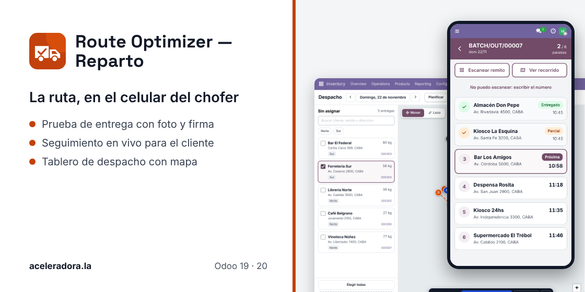
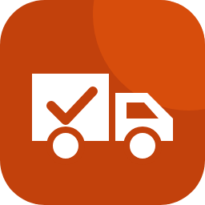
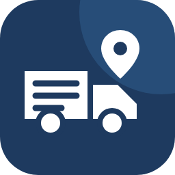
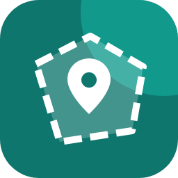

# Route Optimizer para Odoo

Planificá, repartí y seguí tus entregas desde Odoo. Community y Enterprise.



## Módulos

| | Módulo | Qué hace | Odoo |
|---|---|---|---|
|  | **Route Optimizer** `route_optimizer` | Ordena las entregas de un lote: varios vehículos, capacidad, ventanas horarias, hoja de ruta en PDF y por WhatsApp. | 17 · 18 · 19 · 20 |
|  | **Reparto** `route_optimizer_delivery` | App del chofer con prueba de entrega, seguimiento para el cliente y despacho con mapa. | 19 · 20 |
|  | **Flota** `route_optimizer_fleet` | Vehículo de Flota en el optimizador, con su capacidad precargada. | 17 · 18 · 19 · 20 |
|  | **Zonas de Entrega** `delivery_zone` | Zonas detectadas desde Google My Maps y lotes automáticos por zona. No requiere los demás. | 17 · 18 · 19 · 20 |

## Instalación

1. Cloná la rama de tu versión de Odoo (`17.0`, `18.0` o `19.0`) y sumá la carpeta al `addons_path`. Para Odoo 20, generá el árbol con `python tools/port_to_version.py 20.0`.
2. En Odoo 18 y 19, instalá `stock_partner_delivery_window` de [OCA/stock-logistics-workflow](https://github.com/OCA/stock-logistics-workflow) y sus dependencias.
3. Levantá OSRM y el servicio OR-Tools de [`ortools_service/`](ortools_service/): [manual de despliegue](DEPLOYMENT_MANUAL_SECURE.md).
4. Instalá los módulos y completá **Ajustes → Inventario → Optimización de rutas**.

## Motores de ruteo

| Opción | Matrices | Solver | Costo |
|---|---|---|---|
| Propio (por defecto) | OSRM | OR-Tools | El servidor |
| Híbrido, con tráfico real | Google Routes | OR-Tools | Por elemento de matriz |
| Google completo | — | Google Route Optimization | Por envío |

Guía del modo híbrido: [GOOGLE_HYBRID_SETUP.md](GOOGLE_HYBRID_SETUP.md).

Con Google como motor, las horas estimadas y el dibujo de cada ruta salen de Routes API con tráfico (un pedido por ruta). El mapa del despacho puede ser OpenStreetMap o Google Maps (*Ajustes → Inventario → Reparto*): con Google suma tráfico en vivo y satélite, y pide una clave de Maps JavaScript API aparte, restringida por dominio.

## Uso

- **Optimizar**: en un traslado por lote, botón *Optimizar ruta*.
- **Repartir**: el chofer es el *Responsable* del lote y entra por el menú *Reparto* (`/odoo/reparto`); desde ahí instala la app en su celular. Alcanza con el grupo *Chofer de reparto*.
- **Seguir**: cada entrega tiene un link público de seguimiento, en la pestaña *Entrega* del traslado.
- **Despachar**: *Inventario → Operaciones → Tablero de despacho* (`/odoo/despacho`). Elegí entregas en la lista, en el mapa o con el lazo; el panel ordena las rutas por lo que cuesta sumarlas. *Publicar a choferes* confirma las rutas en borrador. *En vivo* muestra camiones, atrasos e incidencias.
- **Zonas**: pegá la URL de tu Google My Maps en *Ajustes → Inventario → Zonas de entrega* y sincronizá.

Los avisos por correo al cliente y la validación del traslado al entregar vienen apagados: se activan en *Ajustes → Inventario → Reparto*.

## Desarrollo

```bash
odoo-bin -d test -i route_optimizer_delivery --test-tags /route_optimizer_delivery --stop-after-init
python tools/validate_views.py 19.0
python tools/port_to_version.py 20.0   # lleva el árbol de 19.0 a 20.0, 18.0 o 17.0
```

## Desarrollado por

**[aceleradora.la](https://aceleradora.la)** — implementación y desarrollo Odoo.
Soporte y consultas: [info@aceleradora.la](mailto:info@aceleradora.la)

Licencia [LGPL-3](LICENSE).
